# UML основных процессов GoDeck

Документ описывает backend как систему взаимодействующих модулей и методов. «Действующие лица» на
sequence-диаграммах — контроллеры, сервисные методы, транзакционные границы, репозитории, worker,
AI-провайдер и файловое хранилище. Браузер показан только как внешняя граница протокола.

Диаграммы написаны на Mermaid и отображаются непосредственно в GitLab. Они документируют текущую
реализацию, а не желаемую архитектуру.

## Как читать диаграммы

- `Controller.method` принимает HTTP-запрос, извлекает principal и формирует HTTP-ответ.
- `Service.method` выполняет прикладной сценарий и проверяет бизнес-правила.
- `Transactions.method` — короткая транзакция с блокировкой или атомарной публикацией.
- `Repository` — PostgreSQL/JPA, durable source of truth для статусов, версий и черновиков.
- `TemplateService` и `PresentationFiles` — преобразование semantic content в PPTX и безопасное
  хранение файлов.
- `PresentationContent` — каноническая семантическая модель: значения полей, порядок/видимость
  слайдов, дополнительные текстовые и графические блоки, позиции template-owned text shapes.
- Пунктирная стрелка означает возврат результата. Сплошная — вызов или передачу данных.

## 1. Карта основных модулей

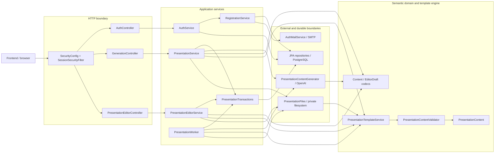

Главная граница архитектуры: HTTP-слой не работает напрямую с JPA-сущностями или путями файлов.
Прикладные сервисы оперируют semantic content и immutable snapshot-объектами. Медленные операции
(OpenAI, Apache POI, файловая система) выполняются вне транзакции; короткие методы
`PresentationTransactions` резервируют работу и затем атомарно публикуют результат.

## 2. Регистрация, подтверждение и создание сессии

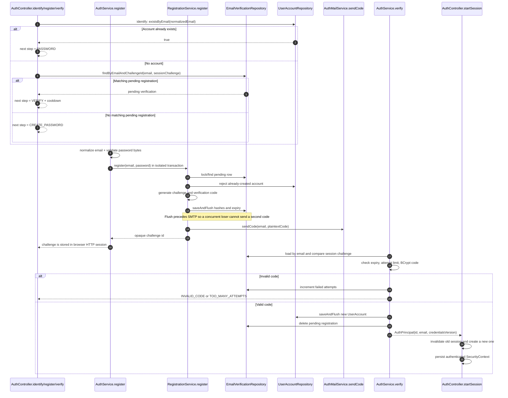

Зачем здесь два сервиса: `RegistrationService.register` владеет одной транзакцией вставки и SMTP.
`AuthService.register` запускает её без окружающей транзакции, поэтому при конкурентной вставке
проигравшая транзакция успевает полностью откатиться до повторного чтения строки победителя.

## 3. Проверка сессии и защита HTTP-запроса

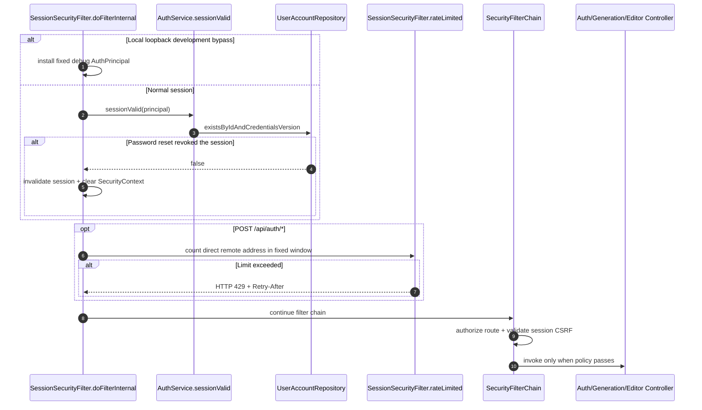

`credentialsVersion` делает смену пароля глобальным отзывом старых сессий без отдельной таблицы
session-токенов. CSRF остаётся включённым и для анонимных state-changing auth endpoints.

## 4. Создание презентации и асинхронная AI-генерация

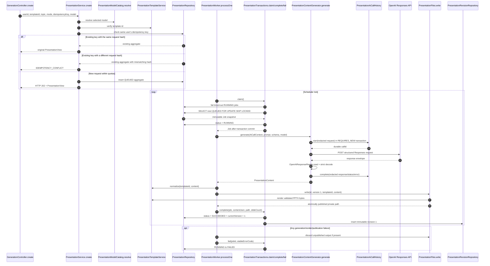

Важный инвариант: AI-вызов и запись PPTX не удерживают блокировку БД. Файл получает уникальное имя и
публикуется атомарным move до второй транзакции. Если commit БД не состоялся, orchestration удаляет
неиспользуемый файл; ранее опубликованная версия не меняется.

## 5. Ручная генерация без AI

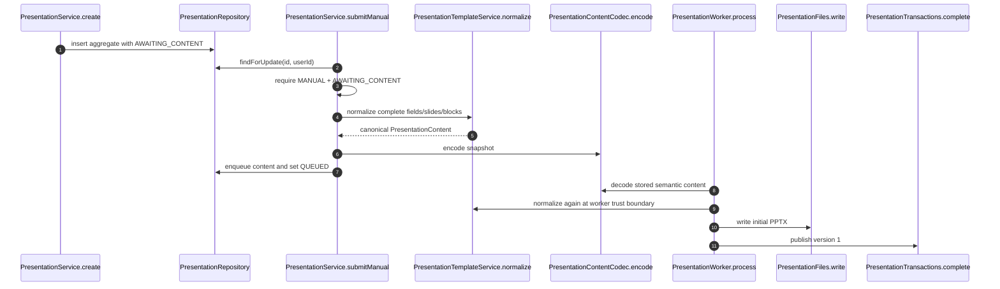

Ручной режим использует тот же validator, renderer, очередь и version history, что AI-режим. Отличие
только в источнике semantic content; поэтому экспорт не имеет отдельной, постепенно расходящейся
ветки реализации.

## 6. Открытие редактора и autosave черновика

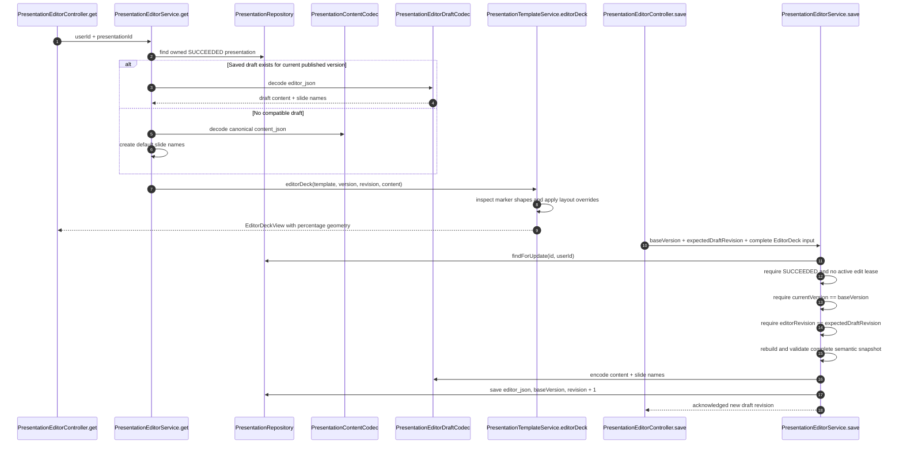

Autosave хранит целый snapshot, а не поток UI-команд. Это упрощает восстановление после обновления
страницы и делает каждый revision самодостаточным. `baseVersion` защищает от сохранения поверх новой
опубликованной версии, `editorRevision` — от потери изменений между вкладками. Revision монотонный и
не переиспользуется после clear/commit, что закрывает ABA-сценарий.

## 7. Загрузка и использование изображения

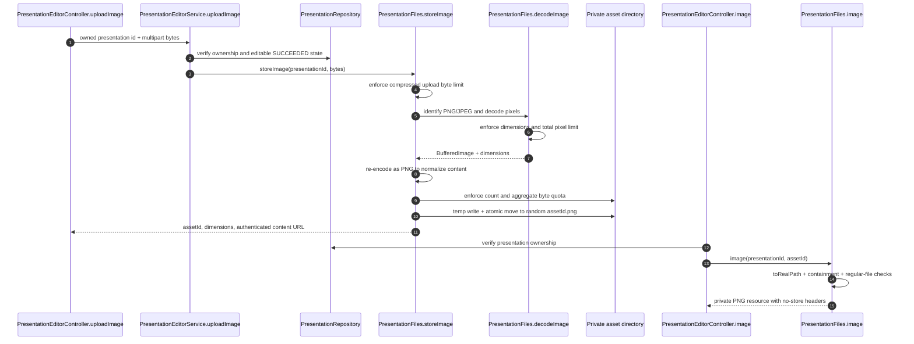

Сам upload ещё не меняет presentation content. Frontend добавляет возвращённый `assetId` в
`ImageBlock` и сохраняет полный editor draft. При commit renderer разрешает только asset ids внутри
каталога этой презентации. Декодирование и повторная PNG-кодировка не дают передать в Apache POI
произвольный файл под ложным MIME type и ограничивают decompression-bomb риск.

## 8. Публикация editor draft как новой версии

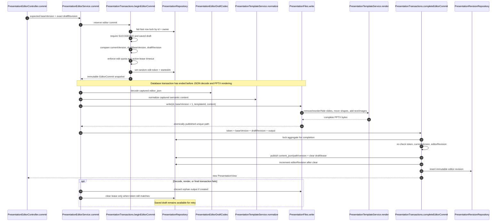

Это двухфазная публикация, но не распределённая транзакция. База — источник истины о текущей версии;
файловая компенсация удаляет обычные orphan-файлы. Аварийное завершение процесса между atomic move и
DB commit теоретически может оставить файл без ссылки — это известная эксплуатационная оговорка.

## 9. Что именно делает PPTX renderer

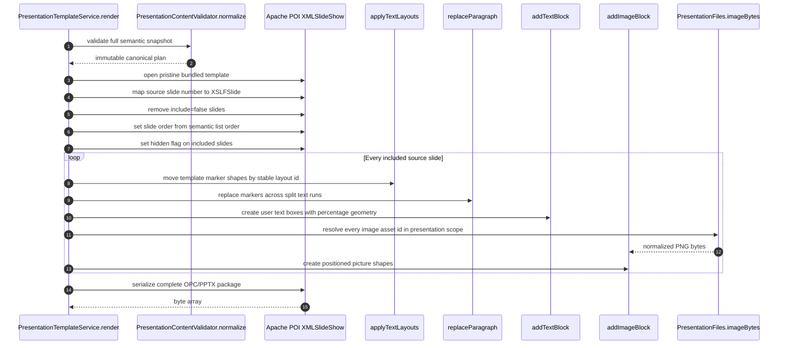

Порядок списка `PresentationContent.slides` — порядок слайдов в результате. `slide` внутри элемента —
не индекс результата, а номер исходного слайда шаблона. `include=false` удаляет source slide;
`hidden=true` оставляет его в deck, но помечает скрытым. Геометрия хранится в процентах, чтобы canvas
960×540 и реальный размер страницы PPTX использовали одну систему координат.

## 10. AI-правка существующей презентации

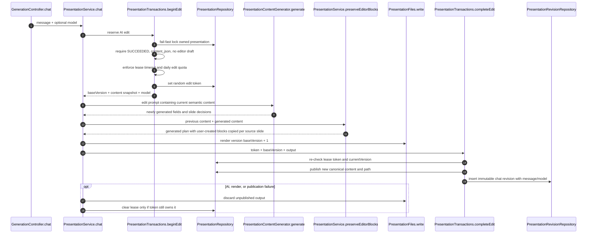

AI-правка запрещена при наличии editor draft: иначе модель начала бы с опубликованного `content_json`
и молча потеряла незакоммиченные UI-изменения. Сгенерированные поля и решения по слайдам считаются
результатом AI, а свободные text/image blocks остаются пользовательскими и переносятся на тот же
source slide.

### 10а. AI-правка текста выбранного блока в редакторе

```mermaid
sequenceDiagram
    participant Panel as AiChatPanel
    participant API as AiEditController
    participant Svc as AiTextEditService
    participant Res as TargetResolver
    participant Reg as TextEditActionRegistry
    participant LLM as AiResponsesClient
    participant DB as PostgreSQL
    Panel->>API: GET /editor/ai/actions (один раз за сессию)
    Panel->>Panel: цель = выбранный блок; source = текущее предложение или текст блока
    Panel->>Panel: saveNow() — дождаться autosave
    Panel->>API: POST /presentations/{id}/editor/ai/text-edits {request_id, action, params, target, text, refines_edit_id}
    API->>Svc: edit(user, id, request)
    Svc->>Res: владелец, статус, цель в сохранённом документе, лимиты, роль, заголовки
    Svc->>Reg: действие и параметры → задача для модели
    Svc->>DB: короткая транзакция: идемпотентность, квота, строка presentation_ai_edits = running
    Svc->>LLM: один запрос Responses API (strict schema), аудит в presentation_ai_calls до HTTP
    LLM-->>Svc: {status, message, variants[]} + usage
    Svc->>Svc: очистка; превышение лимита → предупреждение, без обрезки и без повтора
    Svc->>DB: короткая транзакция: результат, usage, статус
    API-->>Panel: варианты, предупреждения, usage, квота
    Panel->>Panel: карточка «было / стало» → Применить → updateBlock + sealHistory → autosave
```

В отличие от раздела 10, сервер не меняет документ и не берёт метку правки: черновик, ревизии и
PPTX остаются прежними, autosave и экспорт работают параллельно.

## 11. Версии и скачивание

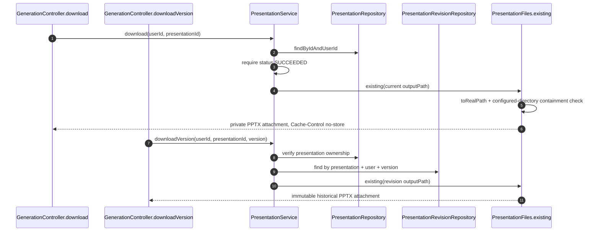

`Presentation` содержит указатель только на текущую опубликованную версию. `PresentationRevision`
хранит immutable snapshot каждой успешной публикации: content JSON, путь PPTX, slide count, сообщение
изменения и использованную AI-модель, если операция обращалась к AI.

## 12. Состояния presentation aggregate

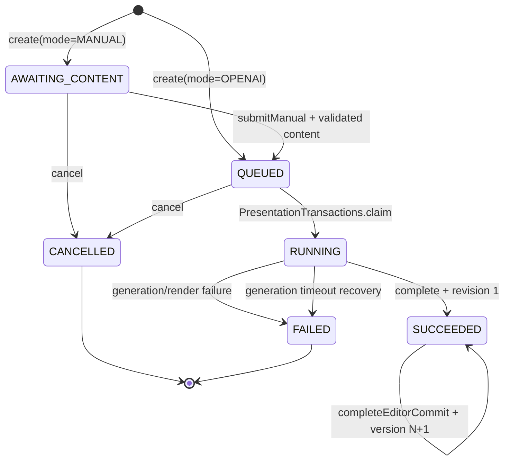

Editor autosave не меняет lifecycle status: у `SUCCEEDED` presentation параллельно может существовать
unpublished draft с `editorBaseVersion` и `editorRevision`. `editId`/`editStartedAt` — не статус, а
короткоживущая lease для единственной дорогой операции публикации.

## 13. Инварианты конкурентности

| Инвариант | Механизм | Зачем |
| --- | --- | --- |
| Два worker не выполняют одну задачу | `FOR UPDATE SKIP LOCKED`, переход `QUEUED → RUNNING` | Горизонтальный запуск worker без глобальной очереди в памяти |
| Повтор create не создаёт дубликат | unique `(user_id, idempotency_key)` + request hash | Безопасный retry браузера после сетевой ошибки |
| Autosave не затирает другую вкладку | compare `baseVersion` и монотонного `editorRevision` | Optimistic concurrency для лёгких черновиков |
| Дорогие правки не коммитятся поверх новой версии | random `editId` + captured `baseVersion` | Отбрасывание устаревшего AI/render результата |
| Старый cleanup не снимает новую lease | token equality перед `clearEdit` | Компенсация принадлежит только своему запросу |
| Draft commit не страдает от ABA | `editorRevision` увеличивается и после clear | Старый revision нельзя повторно принять после recreate |
| Незакоммиченный UI draft не теряется в AI chat | `beginEdit` запрещён при `editor_json != null` | AI всегда начинает с фактически опубликованного snapshot |
| Медленная операция не держит DB lock | begin/claim и complete — разные транзакции | Не занимать соединение во время AI, POI и filesystem I/O |

## Навигация по исходникам

- HTTP presentation API: `presentation/controller/GenerationController` и
  `PresentationEditorController`.
- Прикладные сценарии: `presentation/service/PresentationService` и
  `PresentationEditorService`.
- Транзакционные протоколы: `presentation/service/PresentationTransactions`.
- Очередь: `presentation/worker/PresentationWorker`.
- Semantic model и strict codecs: `presentation/model/PresentationContent`,
  `presentation/mapper/PresentationContentCodec`, `PresentationEditorDraftCodec`.
- Шаблоны и renderer: `presentation/template/PresentationTemplateService` и
  `PresentationContentValidator`.
- Файлы и изображения: `presentation/storage/PresentationFiles`.
- AI: `presentation/ai/PresentationContentGenerator`, `PresentationRequestFactory`,
  `OpenAiResponseReader`.
- Авторизация: `auth/controller/AuthController`, `auth/service/AuthService`,
  `RegistrationService`, `AuthMailService`, `config/SessionSecurityFilter`, `SecurityConfig`.
